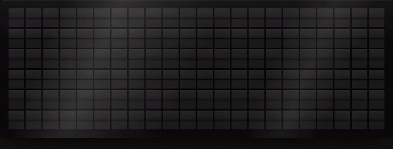

# Ciao Board

A split-flap message board for your wall, inspired by the classic Italian station boards. It runs in any modern browser — no install, no account, no server.

**[Open Ciao Board →](https://nancy-rink.github.io/Ciao-board/)**



## What it does

The board sits at the top (or on the left of a wide screen) with four tabs: **Show** (what's on the board: tap a channel to preview it, then **Put on board**; **Options** sets it up), **Look** (styles, tried on the board before you keep one), **Connect** (your TV remote and friends) and **Settings** (motion, wall display, sound).


- **Messages** — type up to 6 lines of 22 characters; words wrap and center on their own. Drop in color tiles, preview exactly how it will flip, and save favorites.
- **Saved** — keep a list of messages and rotate through them.
- **Clock** — time and date, with 12/24-hour, a second city, borders and accent tiles.
- **News** — BBC headlines (top stories, world, UK, business, technology, science or sport), one at a time.
- **Remote** — use your phone as a full-screen remote for the board on your TV: big buttons to send messages, change the style, show the clock, news or art, start or stop the day plan, and control the sound. Pair once by scanning a QR code on the TV.
- **Friends** — connect with a friend's board (you both have to agree) and send each other messages; the board asks before showing one.
- **Day plan** — change what the board shows, and its style, at set times through the day.
- **58 styles** in seven groups: Everyday (one card with six colors: Classic, Daylight, Mint, Rail, Harbor, Glow), Machines (Solari, Euro rail, Patapata, Cifra clock, Caslon 101, Card ticket, Ikarus, SBB clock, Weltzeituhr), Wayfinding (Metropolitana, Standard, Double Arrow, Oxblood, Földalatti, Warsaw Neon, Ekimei, Taipei Metro, Metro), Identities (Ulm, Olympia 72, Mexico 68, Jet Age, Dangan), Materials (Butterfly, Moquette, Window Grille, Chandigarh, Marine Drive, Filete, Calçadão, Zsolnay, Prague Metro, Cubist, Matyó, Bojagi, Hakka Floral, Barragán) Studio (Cinética, Ton Fan, Graphite, Kassák, Wiener Werkstätte, Plakat) and Museum (Unicorn Tapestry, Belles Heures, Cloister Glass, William, Iznik, Tiffany, Great Wave, Kente, Rose Window: medieval pieces and favorites from the Met). Groups open with a tap, so the picker starts short. Every style has an **About** sheet: the work it's drawn from, who made it and when, a few lines on it and where to see it, with the Met's public-domain photo and a link for Met pieces. Tap a style to try it on the board before you keep it, filter light or dark styles, and star favorites: the <kbd>S</kbd> key, the automatic style change and the Day plan can cycle through just those. **Worn** ages any style with scuffs, faded letters and off-center printing.
- **Accented letters** — Á É Í Ó Ö Ő Ú Ü Ű Ñ Ã Õ Ç Â Ê Ô À have their own flaps, so Spanish, Portuguese and Hungarian messages show correctly. Other accented letters (Ł, Č, Ř…) show as the plain letter.
- **Animation** — realistic flaps with visible edges that settle with a bounce, seven flip patterns (left to right, row by row, diagonal, center out, edges in, random, all at once), new styles that flip in tile by tile, a power-on spin, the odd idle twitch, raised tiles with optional glass glare, and a choice of frames (brushed metal, walnut, matte black, white).
- **Art** — pictures made from color tiles (heart, sunset, rainbow, smile, birthday cake, Ciao, Italian and Norwegian flags) and animations (rainbow wave, sparkle, rain, heartbeat), also available in the Day plan.
- **Wall display** — dims the board during the night hours you choose, and in full screen drifts it a few pixels over time to protect TV screens from burn-in.
- **Sound** — modelled mechanical flaps that match the board style (a heavy station board, a little clock, card, wood, glazed tile, concrete, a bus roll-sign…), the rush of a whole board flipping at once, a soft room echo, left-to-right stereo, warm finish chimes (arrival and departure bells, vibraphone, tubular bell, kalimba, celesta), an optional quiet background (station hall, rain, café, quiet room), a dozen other click styles, or your own recording.
- **Full screen** — fills a TV, tablet or monitor and keeps the screen awake.
- **Smooth mode** — on TVs and other slow screens the board draws every tile face ahead of time and animates the whole board on a single canvas, caps how many flaps each tile turns, and drops its costliest effects, so flips stay fluid. It's on automatically in TV mode, or when the board notices flips running slowly; choose it yourself in Settings → Motion.

Settings are kept in each person's own browser.

## Put it on a wall

- **Smart TV:** in the TV's web browser, go to **is.gd/ciaoboard** (or `nancy-rink.github.io/Ciao-board/tv`). It opens in TV mode: the board alone, filling the screen. Press **OK** on the remote to go full screen; after that, **OK** shows or hides the controls. Then pin the page so it's one click away: on Samsung, open the browser's menu and choose **Add to Home**; on LG, choose **Pin to Home**; on Google TV and Fire TV, add it as a bookmark. Turn off the TV's auto power-off (on a Samsung Frame, for example). The TV keeps its own settings, so set its style and Day plan from the TV once.
- **Monitor or laptop:** open the link, tap **Full screen**, or press `H` to hide the controls.
- **iPad or tablet:** open the link in Safari, tap **Share → Add to Home Screen**, then open it from the home screen icon and turn the tablet sideways. Set **Auto-Lock** to Never while it's on the wall.
- **Sound:** browsers only play sound after a tap, so tap the board once. On iPhone or iPad, turn off silent mode.
- **Keyboard:** `S` changes the style and `H` hides the controls (you can turn these off in Settings).

## Host your own copy

The board is plain HTML, CSS and JavaScript with no build step: `index.html`, the stylesheets in `css/`, the scripts in `js/`, and icons and preview images in `assets/`.

1. Fork this repository, or create a new public one and upload all of its files.
2. Go to **Settings → Pages**. Under **Build and deployment**, choose **Deploy from a branch**, pick `main` and `/ (root)`, and click **Save**.
3. After a minute or two, your board is live at `https://<your-username>.github.io/<repository-name>/`.

If you host it somewhere else, change the two `og:` links near the top of `index.html` to your own address so link previews keep working.

BBC's feeds can't be read straight from a web page, so a GitHub Action (`.github/workflows/news.yml`) fetches the headlines every 20 minutes and saves them to the `news-data` branch, where the board picks them up. In your own copy, change `NEWS_URL` in `index.html` to point at your repository. GitHub pauses scheduled Actions after 60 days without any commits; re-enable it on the **Actions** tab if headlines stop updating.

## Use your phone as a TV remote

1. On the TV, open the board (for example at **is.gd/ciaoboard**). Its start screen shows a big QR code and a 6-digit pairing code. (Past the start screen? Press **OK** for the controls, open **Connect** and choose **Pair a phone**.)
2. Scan the QR code with your phone's camera. It opens the remote and connects by itself, and the TV's start screen closes when it's done. (Or open **nancy-rink.github.io/Ciao-board/remote** on your phone and type the 6 numbers; it connects as soon as the last one is in.)
3. Your phone is now a full-screen remote: type a message and tap **Show on TV**, tap big buttons for the clock, news, art, saved messages, the day plan or a clear board, swipe through styles, and mute or turn the volume up and down. **More** has the flap sound, chime and animation quality. The top line shows what the TV is displaying.
4. Add the remote to your home screen (in Safari, **Share → Add to Home Screen**) so it opens like an app.

The same controls are also on the board itself, under **Connect**.

If the TV is switched off, the remote says it can't reach it, and reconnects by itself as soon as the board is open on the TV again. Only if the TV's browser data was cleared do you need **Pair again**: scan the code on the TV's start screen and the new pairing replaces the old one. A home-screen remote on iPhone keeps its own storage, separate from Safari, so pair once from the home-screen remote itself by typing the code. A paired phone is trusted: the TV acts on its commands straight away. Unpair from either device under **Connect → Paired**. The remote uses the same relay and encryption as Friends, below.

## How Friends works

Messages travel through a relay, so there's nothing to set up. Each board listens on its own random inbox. An invite code lets one friend find your board; when they accept, the two boards run a key exchange, and from then on every message is encrypted with a key only those two boards hold. A relay never sees what's written, and a board ignores anything not encrypted by a connected friend. Share invite codes only with the person you're connecting with.

There are two relays. Ours (`relay/`) runs on Cloudflare Workers' free plan at `ciao-relay.nancyrink.workers.dev` and has no daily message cap; [ntfy.sh](https://ntfy.sh), a free public relay, is the fallback. Every board listens on both. Two boards move their link to ours as soon as each sees the other listens there, and use ntfy.sh if ours can't be reached or the other board hasn't updated yet. ntfy.sh allows 250 messages a day per internet connection.

Both relays keep messages for 12 hours, so a board that's switched off longer than that misses them. A board's connections live in its browser: clearing browser data or switching browsers means connecting again.

### Our relay

`relay/src/index.js` is a small Cloudflare Worker with one Durable Object per inbox, speaking the part of ntfy's API the board uses (post, poll, and a live WebSocket). Idle connections hibernate, so a TV left on all day costs nothing. Cloudflare deploys it itself whenever `relay/` changes on main (Workers & Pages → ciao-relay, connected to this repository with the root directory `/relay`). To run it locally: `npm --prefix relay install` and `npm --prefix relay run dev`. In your own copy, change `CF` in `js/friends.js` to your Worker's address.

## How the code is laid out

- `index.html`: the page itself.
- `css/`: `board.css` (tokens, flaps, motion), `styles.css` (the board styles), `app.css` (the controls around the board), `tv-remote.css` (TV mode, the phone remote, pairing).
- `js/`: plain scripts loaded in order. They share one scope, as if they were one file: `core.js` (basics, tiles, the Smooth mode canvas), `engine.js` (layout and the flip engine), `sound.js`, `modes.js` (messages, clock, weather, surf, calendar, news), `friends.js` (the relay and encrypted links), `remote.js` (the phone remote and TV pairing), `art.js`, `wall.js` (wall display, Day plan, full screen, TV mode), `ui.js` (cards and the sheet), `styles.js` (styles and the picker), and `start.js`, which runs last and starts everything. Anything that needs every file loaded starts from `start.js` (or `onReady`), never from a timer in its own file.
- After changing a file in `css/` or `js/`, run `python3 scripts/stamp.py`. It updates the `?v=` stamps in `index.html`, so browsers fetch the new file instead of a cached one. The tests workflow fails if a stamp is out of date.

## Tests

The board has no build step; the tests are the only thing that needs installing. They open the board in Chromium against a local copy of the site, a local stand-in for ntfy.sh, and our relay running locally, so they never touch the real relays.

```sh
npm install
npm install --prefix relay
npx playwright install chromium   # once
npm test
```

They also run on every pull request (`.github/workflows/test.yml`).

## License

MIT — see [LICENSE](LICENSE).

Made with Claude.
